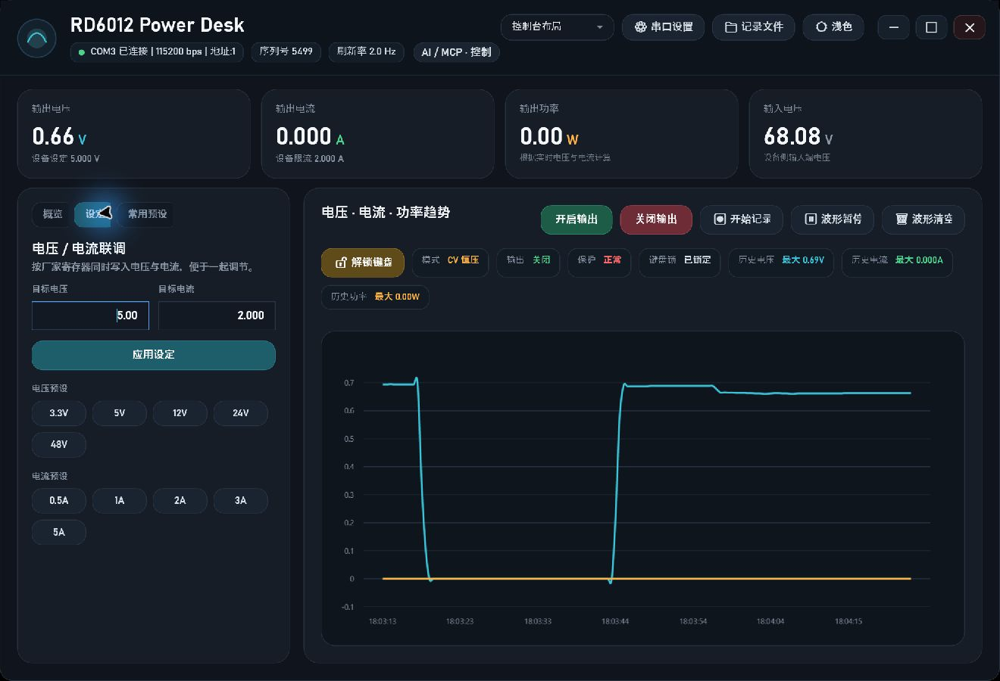

# PowerSupplyController

Windows 电源上位机，基于 .NET 10 和 WPF。它通过 Modbus RTU 串口连接 RD 系列数控电源，提供实时读数、趋势曲线、电压与限流设定、输出控制、CSV 记录，以及供本机 AI 客户端使用的内置 MCP 服务。



上图是设备在线时的实际界面截图。读数和曲线仅展示截图当时的状态，不代表设备性能指标。

## 功能

- 同屏查看输出电压、电流、功率及其历史趋势，并查看设备状态和保护信息。
- 成对设置目标电压与限流；输出开关采用独立按钮，开启前要求确认。
- 保存 CSV 测量记录，支持深浅色及两种界面布局。
- 运行内置 Streamable HTTP MCP，供本机 AI 客户端读取状态；写入权限默认关闭，开启后仍受用户配置的电压和电流上限约束。

## 构建和运行

需要 Windows、.NET 10 SDK，以及可用的串口驱动。首次运行请在“串口设置”里核对端口、波特率和设备地址；不要直接采用示例端口号。

```powershell
dotnet build app/PowerSupplyController
dotnet run --project app/PowerSupplyController
```

只查看界面、不在启动时自动连接串口：

```powershell
dotnet run --project app/PowerSupplyController -- --offline
```

`--offline` 只跳过启动时的自动连接，不是模拟设备；之后仍可手动连接真实电源。

## MCP 接入

上位机打开时默认提供 `http://127.0.0.1:6012/mcp`。客户端必须支持 MCP Streamable HTTP，并在请求中携带界面生成的 Bearer 令牌。MCP 与界面共用一个串口连接，不另外占用 COM 口。初始为只读，默认 AI 限值为 5 V / 0.5 A；要写入设备，须在“AI / MCP”面板明确开启控制并保存限值。

完整的客户端配置、工具参数、返回值及故障处理见 [MCP 使用说明](docs/MCP使用说明.md)。[空载实机测试记录](docs/MCP实机测试记录-20260927.md)记录了当时的测试条件与边界；不应把它当作带载或精度认证。

## 目录

| 路径 | 内容 |
| --- | --- |
| `app/PowerSupplyController/` | WPF 界面、串口通信、状态管理和内置 MCP 服务 |
| `docs/` | MCP 使用说明、测试记录与界面截图 |
| `tests/PowerSupplyController.Mcp.Tests/` | 使用模拟设备的 MCP 自动检查 |
| `scripts/Test-Mcp.ps1` | 已运行上位机的只读 MCP 连接检查 |

## 验证

```powershell
dotnet build app/PowerSupplyController
dotnet run --project tests/PowerSupplyController.Mcp.Tests
```

自动检查使用模拟设备，不会连接真实电源。实际寄存器语义、限值和接线应以所用型号的厂家协议及设备手册为准。开启输出前请核对负载、目标电压和限流。

此公开仓库未附带开源许可证；如需复制、修改或分发代码，请先取得权利人许可。
